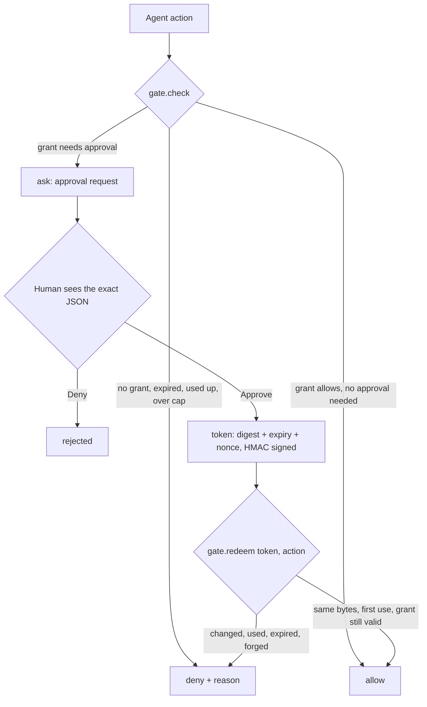
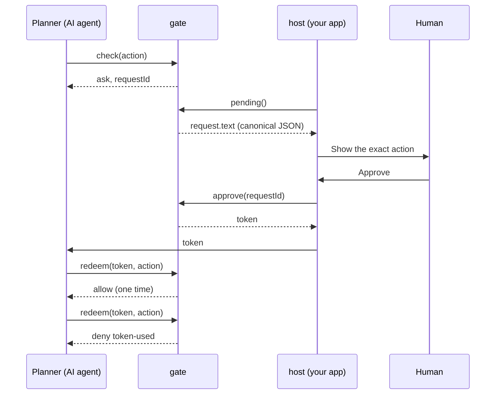

# foxgate

[](https://www.npmjs.com/package/foxgate)
[](https://www.npmjs.com/package/foxgate)
[](https://www.npmjs.com/package/foxgate)
[](https://www.npmjs.com/package/foxgate)

[Package](https://www.npmjs.com/package/foxgate) · [Quickstart](#check-your-first-action) · [API](#createfoxgateoptions) · [Limits](#deliverybehavior-limits)

foxgate is an open-source TypeScript policy library for developers who authorize AI agent tool calls.
It returns `allow`, `deny`, or `ask` from domain grants, approval rules, and spend limits.
Your application enforces each decision before it executes an action.

## Install

```sh
npm install foxgate
```

Requires Node.js 24 or later for the declared Node runtime.
The core also runs in Firefox extensions with Web Crypto support.
It includes TypeScript declarations and has zero runtime dependencies.

## Check your first action

Save this code as `example.mjs`:

```js
import { createFoxgate } from "foxgate";

const { gate, host } = createFoxgate({ tools: { submit: "submit" } });
await host.addGrant({ scope: "submit", domains: ["shop.example.com"] });
const action = {
  tool: "submit", args: { cart: "demo" },
  domain: "shop.example.com", scope: "submit",
};
const decision = await gate.check(action);
if (decision.decision !== "ask") throw new Error("Expected approval request");
console.log(decision.decision); // ask
console.log((await host.pending())[0].text); // JSON for your approval UI

// Demo only: simulate a human approval. Production code must collect that answer.
const token = await host.approve(decision.requestId);
const approved = await gate.redeem(token, action);
console.log(approved.decision); // allow
if (approved.decision === "allow") console.log(approved.action);
console.log((await gate.redeem(token, action)).reason); // token-used
```

Run `node example.mjs`. Expect `ask`, the canonical action JSON, `allow`, and `token-used`.
No credentials, environment variables, or `.env` loader are required.
The example authorizes a simulated action; it does not submit a form.
Keep `host` outside the planner's execution context.

## How it works



1. `check` looks up the tool in the host tool registry. An unknown tool, or a
   scope or amount that differs from the registry, gets `deny`. The amount
   comes from the host function for that tool, not from the planner.
2. It normalizes the action. It turns the domain into lowercase punycode and
   writes the action as canonical JSON (sorted keys).
3. It finds a grant with the same scope, a matching domain, and the tool.
4. It refuses the action when the grant has expired, has no uses left, or the
   amount takes it over its spend cap. It does not ask a human about an action
   that cannot run.
5. For a grant that needs approval, it stores a request with the canonical
   text and its SHA-256 digest.
6. `approve` signs a token with an HMAC-SHA256 key that JavaScript cannot
   export. The token holds the digest, an expiry time, and a one-time nonce.
7. `redeem` checks the signature, the expiry, and the nonce. It uses the token
   up, then compares the digest and checks the grant again.



All state changes in one gate run one at a time, so two actions cannot pass a
cap together. This holds for one gate only, so use one gate for each store.
foxgate stores the latest time it saw, so a clock that goes back cannot make
an expired grant or token valid again. It stores valid nonces, not used ones,
so lost storage makes tokens invalid.

## Why it exists

An agent's tool loop needs a decision before it submits data or spends money.
Open Policy Agent and Cerbos provide broader policy authorization systems.
foxgate keeps domain grants, approval requests, one-use tokens, and spend accounting inside your JavaScript application.

## Compare

Scope checked on 2026-10-14 against the linked product documentation.

| Scope | foxgate | [Open Policy Agent](https://www.openpolicyagent.org/docs) | [Cerbos](https://docs.cerbos.dev/cerbos/latest/index.html) |
| --- | --- | --- | --- |
| Primary focus | Agent action grants and approval tokens | General-purpose policy evaluation | Application authorization |
| Setup here | In-process TypeScript library | Policy engine | Policy decision point |
| Configuration | Tool registry, grants, user rules | Policies | Policies |

## Coverage

Source inventory: four action scopes, two storage adapters, and three user-rule effects.
foxgate has no built-in LangChain, Vercel AI SDK, or vendor API adapter.
Your code wraps those calls if needed.
No credential-based vendor integration tests apply to the core library.

| Runtime or surface | Status | Scope |
| --- | --- | --- |
| Node.js | Implemented | In-process policy checks with Web Crypto |
| Firefox WebExtensions | Implemented | Storage adapter and demo approval interface |
| Web Crypto | Implemented | Signed tokens and action digests |
| `memoryStore` | Implemented | Ephemeral state |
| `storageAreaStore` | Implemented | WebExtension-compatible storage area |
| Public suffix provider | Caller-supplied | Required for wildcard grants and registrable-domain rules |
| Managed policy service | — | No server is included |

## Common use cases

1. Node.js agent authors check a tool call before their executor sends email.
2. Firefox extension developers keep one gate in a background context and render pending requests in a popup.
3. Tool-server authors wrap Model Context Protocol (MCP) handlers with checks and human approval handling.
4. QA teams grant access to exact staging hosts instead of broad domain substrings.
5. Automation teams cap declared payment amounts through host-owned pricing functions and a single gate instance.

## Features

- Four scopes separate `read`, `fill`, `submit`, and `pay` grants.
- Approval tokens bind canonical action data and permit one redemption.
- Domain matching supports exact hosts and validated wildcard subdomains.
- Spend caps, expiry, and use counts restrict matching grants.
- User rules apply `allow`, `ask`, or `deny` to `read` and `submit` actions.
- The `onDecision` hook records decisions and fails closed when it throws.

## Runtime surfaces

This package is a library only. It has no CLI and no MCP server. A policy
check depends on stored state (uses, spend, waiting requests) and on a key
that lives in one process. A one-shot command cannot keep either, so a CLI
would show answers that differ from the real gate.

### `createFoxgate(options)`

Returns `{ gate, host }`. Both objects are frozen.

| Option | Default | What it does |
|---|---|---|
| `tools` | required | `{ name: scope }` or `{ name: { scope, amount } }`. Every tool the planner may use. `amount(args)` returns `{ value, currency }`, and a `pay` tool needs it. |
| `store` | `memoryStore()` | Where grants, requests, and spend live. |
| `ruleStore` | `store` | Where user rules live. Give a lasting store, for example `storageAreaStore(browser.storage.local)`, to keep rules across restarts. |
| `now` | `Date.now` | The clock, in ms since 1970. If it returns a value that is not a finite number, `check` and `redeem` give `deny` `clock-error`. |
| `publicSuffix` | none | `{ getDomain(host) }`. Needed for `*.` patterns. In Firefox 153+, pass `browser.publicSuffix`. |
| `onDecision` | none | `(event) => void \| Promise<void>`. Runs before each decision takes effect. If it throws, the answer is `deny` `hook-failed`. |
| `key` | a new key | A non-exportable HMAC SHA-256 `CryptoKey` with the usages `sign` and `verify`. |
| `requestTtlMs` | 10 minutes | How long a request waits for a human. |
| `tokenTtlMs` | 2 minutes | How long a token is valid. |
| `maxPending` | 20 | The most requests that can wait at one time. |

### `gate` (give this to the planner)

| Method | Returns |
|---|---|
| `check(action)` | `allow` with the normalized `action` (and counts one use and the amount), `ask` with a `requestId`, or `deny` with a `reason`. |
| `redeem(token, action)` | `allow` with the normalized `action` (and counts one use and the amount), or `deny`. Any try uses the token up. |

An action is `{ tool, args, domain, scope, amount? }`. `scope` is `read`,
`fill`, `submit`, or `pay`, and it must be the scope that the host registered
for the tool. `args` is a JSON object. `amount` is `{ value, currency }` in
whole minor units (cents). You can leave it out: foxgate takes the amount
from the host function for the tool. A different amount gives `deny`
`wrong-amount`. Any other field gives `deny` `bad-action`.

When the answer is `allow`, run `decision.action`, not your own copy. It is
the action that foxgate judged: the domain in punycode, the args as plain
JSON, and the amount from the host function.

### `host` (keep this away from the planner)

| Method | What it does |
|---|---|
| `addGrant(grant)` | Adds a grant and returns it with its `id`. Throws a `FoxgateError` for a bad grant. |
| `revokeGrant(id)` | Removes the grant and its waiting requests. |
| `grants()` | All grants, with `uses` and `spent`. |
| `pending()` | Requests that wait for a human. `text` is the canonical JSON to show. |
| `approve(requestId)` | Returns a token for that exact action. |
| `reject(requestId)` | The same action gets `deny` `rejected` until the request expires. |
| `addRule(rule)` | Adds a user rule and returns it with its `id`. Throws a `FoxgateError` `bad-rule` for a bad rule. |
| `removeRule(id)` | Removes the rule. Returns `false` for an unknown ID. |
| `rules()` | The rules that have not expired. |

A grant is `{ scope, domains, tools?, spendCap?, expiresAt?, maxUses?, approval?, rules? }`.
A domain is an exact host (`shop.example.com`) or `*.` plus a host for its
subdomains only. `approval` is `"always"` or `"never"`. The default is
`"always"` for `submit` and `pay`, and `"never"` for `read` and `fill`.
`rules: true` lets an `allow` user rule skip the approval of this grant. The
default is `false`.

### User rules

A user rule is a standing answer for one site:
`{ site, scope, tool?, effect, expiresAt? }`. `site` is a registrable domain
(`example.com`, not `mail.example.com`), and the rule covers it and its
subdomains. `scope` is `read` or `submit`. foxgate refuses rules for `pay` and
`fill`. `tool` limits the rule to one tool. `effect` is one of these:

- `allow`: skip the human, on a grant that has `rules: true`.
- `ask`: ask a human, also on a grant that never asks.
- `deny`: refuse with `deny` `rule`. This also stops a token that was
  already approved.

A rule changes only the approval step of a grant that matches. It never
allows an action that no grant allows, and it never skips an expiry, a use
limit, or a spend cap. When rules disagree, `deny` wins over `ask`, and `ask`
wins over `allow`. A decision that a rule made holds `ruleId`, also in the
`onDecision` event, so an audit log can record which rule decided.

Leave `rules` out of a grant when an `allow` must not skip the human. For
example, after an agent run reads private data, foxmate adds its grants
without `rules`, so an `allow` rule cannot let the data out without a human.

```js
import { createFoxgate, storageAreaStore } from "foxgate";

const { gate, host } = createFoxgate({
  tools: { click: "submit" },
  publicSuffix: browser.publicSuffix,
  ruleStore: storageAreaStore(browser.storage.local),
});
await host.addGrant({ scope: "submit", domains: ["shop.example.com"], rules: true });
const rule = await host.addRule({ site: "example.com", scope: "submit", tool: "click", effect: "allow" });
const d = await gate.check({ tool: "click", args: { controlId: "buy" }, domain: "shop.example.com", scope: "submit" });
console.log(d.decision, d.ruleId === rule.id); // "allow" true
```

### Deny reasons

`bad-action`, `unknown-tool`, `wrong-scope`, `wrong-amount`, `no-grant`, `expired`, `used-up`, `spend-cap`, `currency`,
`too-many-requests`, `bad-token`, `token-expired`, `token-used`,
`action-changed`, `rejected`, `hook-failed`, `storage-error`, `clock-error`, `rule`.

### Other exports

| Export | What it does |
|---|---|
| `memoryStore()` | Storage in memory. |
| `storageAreaStore(area)` | Storage in a WebExtension area, for example `browser.storage.local`. |
| `visibleAction(action)`, `visibleValue(value)` | Escapes invisible characters for approval displays. |
| `canonicalJson(value)` | Sorted-key JSON. Throws for values that JSON cannot hold exactly. |
| `normalizeHost(host)` | Lowercase punycode host. Throws for a URL, a port, or a path. |
| `parsePattern(pattern, publicSuffix?)`, `matchesPattern(host, pattern)` | The domain rules that grants use. |
| `parseSite(site, publicSuffix?)` | The normalized registrable domain, the form that a rule `site` needs. Throws `bad-domain` for anything else. |
| `FoxgateError` | Has a `code`: `not-json`, `too-large`, `bad-domain`, `bad-grant`, `bad-action`, `not-found`, `bad-state`, `bad-key`, `hook-failed`, `bad-tools`, or `bad-rule`. |

### Extension

`extension/` is a walkthrough for Firefox 153+. A simulated agent asks to submit a
checkout form. The popup shows the waiting request with Approve and Deny, and
buttons that run the approved action or a changed one.

```bash
pnpm install
pnpm e2e          # loads the demo in Firefox and drives the popup
pnpm build:ext    # builds dist-ext/; load it from about:debugging
```

## Delivery/behavior limits

- foxgate decides. It does not enforce. Your code must call `check` or
  `redeem` before each action and obey the answer.
- The planner still writes the domain and the args. Your executor must run the
  tool on that domain with those args, and your `amount` function must read
  the same args that the executor charges.
- The `gate` and `host` split works only when the planner cannot reach the
  `host` object. Run the planner in another context, for example a sandboxed
  page or another process.
- Checks run one at a time inside one gate. Two gates on the same storage (for
  example one in a popup and one in the background) can race. Run one gate,
  in the background page.
- `addRule` and `removeRule` read, change, and write the rule list with no
  lock across gates. Two gates on one `ruleStore` can lose a rule change.
- The signing key lives in memory. Firefox does not store a `CryptoKey` in
  `storage.local`. When the background page unloads or the app restarts, old
  tokens stop working, and the human must approve again.
- foxgate does not convert currencies or normalize strings. Two strings that
  look the same but differ in bytes are different actions.
- Hosts are names or IPv4 addresses. IPv6 hosts are not supported.
- `*.` patterns need a public suffix list. In Node, pass your own.
- All state is one JSON record that foxgate rewrites on each decision. This is
  fine for tens of grants, not for thousands.
- The demo extension does not open the popup by itself and does not block
  network requests.

## Integration guides

- [Node.js authorization loop](#check-your-first-action): check, collect approval, redeem, and execute the returned action.
- [Firefox storage and user rules](#user-rules): keep rules in a WebExtension storage area.
- [Firefox demo extension](#extension): build and inspect the approval walkthrough.

## Status

Version 0.1.5 is a 0.x release. Interfaces and storage formats can change.
Use the issue channel listed on the [npm package](https://www.npmjs.com/package/foxgate) for support.
Public customer case studies are not published here.

## FAQ

### What does foxgate authorize?

foxgate authorizes registered tool actions under grants and rules.
Your executor must check and enforce the decision before performing the action.

### Which integrations are verified?

foxgate implements Web Crypto signing and memory or WebExtension-compatible storage adapters.
It has no built-in vendor API integrations to credential-check.

### Does foxgate provide a managed authorization service?

foxgate is an in-process library.
You operate the policy state, approval interface, and executor.

### How is foxgate different from Open Policy Agent?

foxgate provides JavaScript action grants and approval-token state.
[Open Policy Agent](https://www.openpolicyagent.org/docs) is a general-purpose policy engine.

### How is foxgate different from Cerbos?

foxgate keeps grants and approval tokens within your application.
[Cerbos](https://docs.cerbos.dev/cerbos/latest/index.html) provides an authorization policy decision point.

### Can foxgate enforce a payment cap by itself?

foxgate checks declared amounts derived by your host tool registry.
The executor must charge the approved amount and use one gate for shared accounting.

### Do approvals survive a restart?

foxgate creates an in-memory signing key by default.
Old tokens fail after that key changes; persistent state does not preserve the default key.

### Can an allow rule skip every approval?

foxgate applies allow rules only to matching grants with `rules: true`.
Rules support `read` and `submit`; they never remove expiry, use, or spend limits.

## License

MIT.
